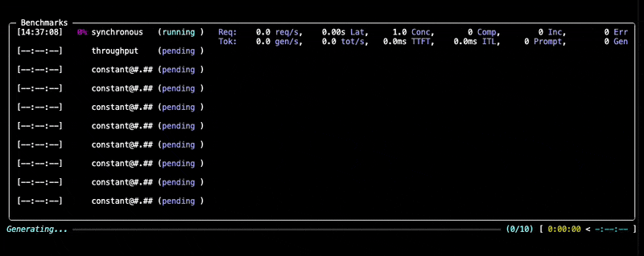
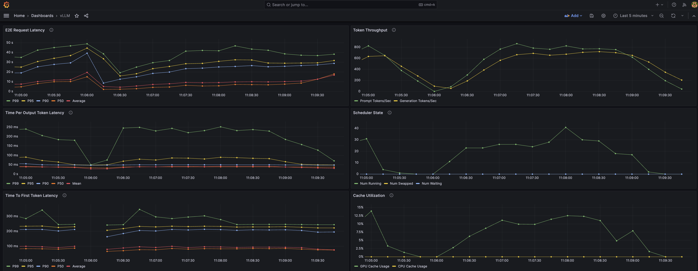

AI spending in 2025 was estimated at £1.36 trillion, of which £748 billion (55%) went towards infrastructure.[^gartner] Future forecasts, estimate £3.1 trillion will be spent on AI infrastructure in 2030.[^gartner] This brings the question, what will be ran this infrastructure and how do we utilise the hardware to the greatest extent possible?

[^gartner]: [Gartner, AI spending forecast](https://www.gartner.com/en/documents/8479345).

As of November 2026, the answer to that is correctly configured vLLM. [vLLM](https://vllm.ai) is an inference and serving engine allowing organisations to squeeze every drop of performance potential from their servers and deploy reliable, scalable applications. This reduction in time to first token (TTFT), end-to-end request latency and more efficient utilisation of GPU hardware has meant that vLLM is now the de facto standard, with day 0 support for all major models and accelerators.

## 🔧&ensp;A basic config

> [!NOTE] Models used in this article
> For this article, I'll use [Inkling-2-Mini](https://huggingface.co/thinkingmachines/Inkling-2-Mini) and [Mistral-Large-4-1T-A52B](https://huggingface.co/mistralai/Mistral-Large-4-1T-A52B) as they're currently best in class among Western open-weight models for their respective sizes. However, all the concepts I speak about will apply to serving any model.

After you've chosen what model to serve, check [vLLM Recipes](https://recipes.vllm.ai) to see if the model has a recipe available. Luckily, despite [Inkling-2-Mini](https://huggingface.co/thinkingmachines/Inkling-2-Mini)'s relatively recent release, one is [available](https://recipes.vllm.ai/thinkingmachines/Inkling-2-Mini). It looks like:

<div id="vllm-basic-config" class="vllm-basic-config">

```
docker run --gpus all \
  --ipc=host -p 8000:8000 \
  -v ~/.cache/huggingface:/root/.cache/huggingface \
  vllm/vllm-openai:inkling-2-mini thinkingmachines/Inkling-2-Mini \
  --tensor-parallel-size 1 \
  --reasoning-parser inkling \
  --tool-call-parser inkling \
  --enable-auto-tool-choice \
  --speculative-config '{"method":"dspark","num_speculative_tokens":7,"draft_sample_method":"probabilistic"}'
```

</div>

The command passes the following [engine arguments](https://docs.vllm.ai/en/stable/configuration/engine_args) to vLLM:
- `--tensor-parallel-size 1` sets the split of individual weight tensors and computations within a model layer across the number of specified GPUs. With the size being one, the model weights sit entirely on a single GPU.
- `--reasoning-parser inkling` selects the reasoning parser to use for extracting the reasoning content from the model output. This argument is required for any reasoning model.
- `--tool-call-parser inkling` turns Inkling’s tool-call output into a structured `tool_calls` entry with the tool name and arguments your application needs to execute the call.
- `--enable-auto-tool-choice` lets Inkling answer directly or request a tool with `tool_choice: "auto"`, avoiding unnecessary tool calls.
- `--speculative-config '{"method":"dspark","num_speculative_tokens":7,"draft_sample_method":"probabilistic"}'` enables [Speculative Decoding](https://arxiv.org/pdf/2302.01318), which uses a [DSpark](https://arxiv.org/pdf/2607.05147) drafter model to make predictions about future tokens while generating current tokens. These predicted tokens are verified before being accepted resulting in zero loss in output quality, but large reductions in inter-token latency leading to much higher token throughput.

This is a good base setup to work off of, but is just the start of the options present to make vLLM ready for production.

## ⚡&ensp;Optimising performance

### 🗜️&ensp;Model quantisations (quants)

Before deciding on any additional arguments to add, it's best to step back and think about the current hardware you'll be using to serve the models. To start with, check what floating-point (FP) format operations are supported by your GPU's microarchitecture. Here’s the smallest FP format each NVIDIA generation supports:

| Microarchitecture | Release Date | Server GPU example | Workstation GPU example        | Smallest FP Operation supported |
| ----------------- | ------------ | ------------------ | ------------------------------ | ------------------------------- |
| [Ampere]          | May 2020     | A100               | RTX A6000                      | FP16 / BF16                     |
| [Hopper]          | October 2022 | H100               | No dedicated workstation model | FP8                             |
| [Ada Lovelace]    | October 2022 | L40                | RTX 6000 Ada Generation        | FP8                             |
| [Blackwell]       | Late 2024    | B100               | RTX PRO 6000 Blackwell         | FP4                             |

[Ampere]: https://www.nvidia.com/en-gb/data-center/nvidia-ampere-gpu-architecture
[Hopper]: https://www.nvidia.com/en-gb/data-center/technologies/hopper-architecture
[Ada Lovelace]: https://www.nvidia.com/en-gb/geforce/ada-lovelace-architecture
[Blackwell]: https://www.nvidia.com/en-gb/data-center/technologies/blackwell-architecture

This means that newer microarchitectures can not only load models with a greater number of parameters due to being able to use smaller model quants, but also support higher throughput due to the smaller FP operations being performed. A model quant is a version of a model that stores the numbers it learned during training with less precision, so the same model takes up less space in GPU memory.

Most recent model releases use BF16 as the default model weight format, but tend to release quants out of the box for Hopper or Blackwell based GPUs that support the smaller formats. For [Mistral-Large-4-1T-A52B](https://huggingface.co/mistralai/Mistral-Large-4-1T-A52B), this means you would use the [NVFP4 checkpoint](https://huggingface.co/mistralai/Mistral-Large-4-1T-A52B-NVFP4) for increases in performance.

### 🌐&ensp;Distributed inference strategies

The optimal distributed inference strategy largely depends on whether the chosen model can fit within the memory of a single GPU or even a single node. For relatively small models like [Inkling-2-Mini](https://huggingface.co/thinkingmachines/Inkling-2-Mini) that use much less VRAM than available, [data parallelism](https://docs.vllm.ai/en/stable/serving/data_parallel_deployment/) should be used to replicate model weights across separate instances/GPUs allowing the processing of many independent batches of requests.

> [!TIP] Multi-node inference
> If a single node lacks sufficient GPUs to hold a model, you can use KubeRay to set up a Ray cluster. vLLM uses Ray to manage the distributed execution of tasks across multiple nodes and control where execution happens. For more information, see the [KubeRay vLLM documentation](https://docs.ray.io/en/master/kuberay/examples/rayserve-llm-example.html).

When the model cannot reside within the memory of a single GPU, tensor parallelism or pipeline parallelism can be used to split the model's weights across numerous GPUs. But, this raises the question - why have two parallelism techniques to resolve this same constraint? The answer to this question can be understood by delving deeper into the topology of multi-GPU servers.

Think of a node with four GPUs, you can run `nvidia-smi topo -m` to see how they connect. There are three ways a four GPU system can connect with three ways in which parallelism should be configured:

1. **PCIe only**

   ```text
          GPU0  GPU1  GPU2  GPU3
   GPU0     X    PIX   PHB   PHB
   GPU1    PIX    X    PHB   PHB
   GPU2    PHB   PHB    X    PIX
   GPU3    PHB   PHB   PIX    X
   ```

   PCIe is the standard, relatively slow, connection a GPU plugs into on a server.

   If the model needs all four GPUs to fit, use **pipeline parallelism** (`--pipeline-parallel-size 4`). Think of it as a relay: GPU0 runs the first part of the model, hands its result to GPU1, and so on. With **tensor parallelism**, the GPUs work on the same layer together and have to share results much more often. Fewer handoffs make the pipeline more optimal for PCIe.

2. **Two NVLink pairs**

   ```text
          GPU0  GPU1  GPU2  GPU3
   GPU0     X   NV12   SYS   SYS
   GPU1   NV12    X    SYS   SYS
   GPU2    SYS   SYS    X   NV12
   GPU3    SYS   SYS  NV12    X
   ```

   [NVLink](https://blogs.nvidia.com/blog/what-is-nvidia-nvlink) is a fast connection that lets GPUs share data without going through PCIe. Some four-GPU servers use two bridges, each connecting just two cards. Here, GPU0 is paired with GPU1, and GPU2 with GPU3. `NV12` means the two GPUs in a pair share 12 NVLink links. There’s no bridge between the pairs, so data takes the slower route through the server (`SYS`).

   If the model needs all four GPUs, try `--tensor-parallel-size 2 --pipeline-parallel-size 2`. Think of it as a relay between two teams: GPU0 and GPU1 work together on the first part of the model, then hand their result to GPU2 and GPU3 for the second part. Each team shares data frequently over NVLink, but only the handoff needs the slower connection.

3. **All four GPUs connected over NVLink**

   ```text
          GPU0  GPU1  GPU2  GPU3
   GPU0     X    NV4   NV4   NV4
   GPU1    NV4    X    NV4   NV4
   GPU2    NV4   NV4    X    NV4
   GPU3    NV4   NV4   NV4    X
   ```

   All GPUs are connected to each other via NVLink, they can share results with all three others without using PCIe.

   If the model needs all four GPUs to fit, try **tensor parallelism** (`--tensor-parallel-size 4`). All four GPUs work on the same layer together. Their frequent exchanges stay on NVLink, so there’s no slower handoff between pairs to plan around.

> [!NOTE]
> See the [NVIDIA System Management Interface documentation](https://docs.nvidia.com/deploy/nvidia-smi/index.html#topology) for the full topology legend.

After explaining these three strategies, you should now have the general gist of when to use each of them. You can also combine them, for example if a model needs the combined memory of two GPUs in a four GPU node you can use `--tensor-parallel-size 2 --data-parallel-size 2` for optimal throughput. For more information on parallelism and scaling see [vLLM's documentation](https://docs.vllm.ai/en/stable/serving/parallelism_scaling/).

### 🖼️&ensp;Multimodal models

Multimodal models support images, video and audio as inputs. In order to improve the performance of multimodal heavy requests, it's worth understanding that multimodal inputs require significant image processing to turn the compressed media into tensors before being passed to the GPU, meaning the CPU can become the bottleneck. This means that increasing the `--api-server-count` may be beneficial.

Another important best practice, is that in order to make sure an overwhelming number of inputs aren't being sent you can use `--limit-mm-per-prompt '{"image":4,"video":1, "audio": 1}'` to limit the inputs per request.

Combining these arguments with [those above](#vllm-basic-config), for [Inkling-2-Mini](https://huggingface.co/thinkingmachines/Inkling-2-Mini) gives us:

<div class="vllm-multimodal-config">

```
docker run --gpus all \
  --ipc=host -p 8000:8000 \
  -v ~/.cache/huggingface:/root/.cache/huggingface \
  vllm/vllm-openai:inkling-2-mini thinkingmachines/Inkling-2-Mini \
  --tensor-parallel-size 1 \
  --reasoning-parser inkling \
  --tool-call-parser inkling \
  --enable-auto-tool-choice \
  --speculative-config '{"method":"dspark","num_speculative_tokens":7,"draft_sample_method":"probabilistic"}' \
  --limit-mm-per-prompt '{"image":4}' \
  --api-server-count 2
```

</div>

> [!TIP] Process images in parallel across GPUs
> For some multimodal models served across several GPUs, you can use `--mm-encoder-tp-mode data`. Instead of having all the GPUs work on the same image, each GPU processes a different image from the batch. This can help you serve more images per second, at the cost of extra GPU memory. For instance, one model that supports this is [Qwen2.5-VL-7B](https://recipes.vllm.ai/Qwen/Qwen2.5-VL-7B-Instruct).

### ⏱️&ensp;Benchmarking and parameter tuning

When modifying the arguments given to vLLM, how do we know the impact each option is making in terms of performance? By running benchmarkings, but before doing so ourself, it's instructive to know a few more important parameters that can be varied to improve performance:

- `--kv-cache-dtype` sets the data type used for the key-value (KV) cache, where information about earlier tokens is stored so they don't have to be recomputed for every new token. Switching from a 16-bit (`bfloat16`) cache to `fp8` roughly halves the cache memory needed per token. That can let you serve more requests at once if the cache is filling up. Lower precision can affect answer quality, so compare it with `auto` for your own use cases.
- `--max-model-len` caps how much of the model’s **context window** a request can use. For example, [Inkling-2-Mini supports 1,048,576 tokens](https://huggingface.co/thinkingmachines/Inkling-2-Mini/blob/main/config.json), but you don’t need to offer the full window for a chat service. If your longest expected prompt is 6,000 tokens including chat history, and you want to allow a 2,000-token answer, start with `--max-model-len 8192`. A lower cap can prevent a few long requests from consuming most of the KV cache. If your requests already fit below the new cap, lowering it doesn’t automatically let you serve more of them at once. A model’s advertised window tells you how much text it can accept, not how reliably it can use every detail. Model performance generally tends to degrade when operating closer to the context window so test answer quality and latency at the lengths your users need.
- `--max-num-batched-tokens` caps the total tokens vLLM processes per step across all requests. A higher limit can help long prompts get their first token sooner; a lower limit can reduce pauses in answers already streaming.
- `--max-num-seqs` limits how many sequences vLLM processes in one scheduling step, not how many requests it accepts. A request asking for one answer produces one sequence; a request asking for three answers produces three. Raising the limit can improve throughput if there’s spare GPU cache; lowering it can avoid pausing and recomputing work when the cache fills up.

#### Example: benchmark Inkling-2-Mini with [GuideLLM](https://vllm-project.github.io/guidellm/stable/)

For the first run, set `--max-num-batched-tokens 2048`. For the second run, raise it to `8192`. In each run, GuideLLM’s [sweep profile](https://vllm-project.github.io/guidellm/stable/getting-started/benchmark/#sweep-profile) keeps those settings fixed and varies the request rate so we can see how latency changes as traffic increases.




```bash
guidellm run \
  --backend '{"kind":"vllm_python","model":"thinkingmachines/Inkling-2-Mini","vllm_config":{"max_model_len":8192,"max_num_batched_tokens":2048,"max_num_seqs":256}}' \
  --profile kind=sweep \
  --data kind=synthetic_text,prompt_tokens=1024,output_tokens=128 \
  --seed kind=static,value=42 \
  --constraint kind=max_duration,seconds=60 \
  --output kind=json,path=tokens-2048_seqs-256.json
```




```bash
guidellm run \
  --backend '{"kind":"vllm_python","model":"thinkingmachines/Inkling-2-Mini","vllm_config":{"max_model_len":8192,"max_num_batched_tokens":8192,"max_num_seqs":256}}' \
  --profile kind=sweep \
  --data kind=synthetic_text,prompt_tokens=1024,output_tokens=128 \
  --seed kind=static,value=42 \
  --constraint kind=max_duration,seconds=60 \
  --output kind=json,path=tokens-8192_seqs-256.json
```




<figure>
  
  <figcaption>

Figure 1. GuideLLM’s terminal progress display during the benchmark in its getting-started guide.[^guidellm-benchmark]

  </figcaption>
</figure>

[^guidellm-benchmark]: [GuideLLM, Run a Benchmark: Basic Example](https://vllm-project.github.io/guidellm/main/getting-started/benchmark/#basic-example).

After the benchmark finishes, the results are clear and recorded in JSON reports. You can then see for yourself on which configuration is best suited to your real-world load.

> [!TIP] Benchmark against real traffic
> Change one setting at a time and benchmark with prompt lengths and concurrency that match your traffic. Compare token throughput, time to first token (TTFT) and the inter-token latency (ITL): a change can improve one while making another worse. See [vLLM’s tuning guide](https://docs.vllm.ai/en/stable/configuration/optimization) and [GuideLLM’s benchmarking best practices](https://vllm-project.github.io/guidellm/stable/examples/practice_on_vllm_simulator/) for more detail.

## 📊&ensp;Enhancing observability

By default, vLLM has rich metrics provided via both a Prometheus compatible `/metrics` endpoint and a configurable [OTEL endpoint](https://docs.vllm.ai/en/stable/examples/observability/opentelemetry/). The project includes a [Prometheus and Grafana dashboard setup](https://github.com/vllm-project/vllm/blob/main/examples/observability/prometheus_grafana/README.md) allowing a pleasant view of all the important metrics you need for monitoring an inference server.

<figure>
  
  <figcaption>

Figure 2. Request latency and token throughput over time on the vLLM Grafana dashboard.[^vllm-dashboard]

  </figcaption>
</figure>

[^vllm-dashboard]: [vLLM, Prometheus and Grafana dashboard example](https://github.com/vllm-project/vllm/blob/main/examples/observability/prometheus_grafana/README.md#import-dashboard).

This is a great base setup, but other AI infrastructure or applications that interact with vLLM may want more information such as the input and output tokens for each request as well as the KV cache utilisation. The input and output token breakdown is especially important for FinOps and usage tracking, but isn't included in streaming `/v1/chat/completions` requests (a common request type) unless the `--enable-force-include-usage` flag is set.

Monitoring the KV cache utilisation is also important, as it is essential for the most efficient LLM routing strategies such as KV-cache aware routing. It is also useful to examine as if a high proportion of the tokens are cache hits, processing time is greatly being improved and can indicate that vLLM consumers have overlapping prompts (e.g., multiple users sending the same agent's system prompt). It's also useful in terms of FinOps, as KV-cache hit tokens can be charged at a much lower rate. For instance, OpenAI currently charges twenty times less for cached input for `gpt-6.2-astra`.[^openai-pricing] To enable it, set the `--kv-cache-metrics` flag.

[^openai-pricing]: [OpenAI, API pricing](https://developers.openai.com/api/docs/pricing).

## 🎛️&ensp;Further configuration

The vast majority of important options have now been specified. However, three useful settings remain:

- Use `--served-model-name` to set the model name that will appear in `/v1/models` as the model ID. AI gateway's can then use this name to discover the model.
- In the same vein, I'd recommend disabling model name validation so that typos or changes in models won't break things for end users. This can be done by setting the `VLLM_SKIP_MODEL_NAME_VALIDATION=1` environment variable.
- Lastly, set `--structured-outputs-config '{"backend":"xgrammar","disable_any_whitespace":true}'` as it reduces output tokens and latency for [structured outputs](https://developers.openai.com/api/docs/guides/structured-outputs). This is because models usually generate newlines and indentation, whereas the compacted JSON takes fewer tokens to produce and leaves more response token budget for data before being cut short.


#### 🔏&ensp;Bonus: watermarking output

What if you want to check whether a passage came from your deployment? vLLM can use a secret key when choosing the next token. The reader sees ordinary text, but a detector with the same key, tokenizer and watermark settings can look for the pattern in the generated answer.[^vllm-watermarking]

Watermarking is off by default and I'd recommend keeping it that way for most deployments unless it's something that is strictly required. For the [Inkling-2-Mini](https://huggingface.co/thinkingmachines/Inkling-2-Mini) configuration above, use the `dual_key_gumbel` algorithm: it supports the configured speculative decoding that is already enabled. Mount a file containing a secret integer at `/run/secrets/vllm-watermark-key` inside the container, then add this argument to the existing vLLM command:

```bash
--watermark-config '{"algorithm":"dual_key_gumbel","key_file":"/run/secrets/vllm-watermark-key"}'
```

To check a generated answer, see [vLLM’s example watermark detection server](https://github.com/vllm-project/vllm/blob/main/examples/basic/online_serving/watermark_detection_server.py). Send the text to its `/detect` endpoint to get a score and an `is_watermarked` verdict. The example uses the **single-key Gumbel detector**; for the `dual_key_gumbel` configuration above, use a **matching dual-key detector**.

[^vllm-watermarking]: [vLLM, Text watermarking](https://docs.vllm.ai/en/stable/features/watermarking/).

## 🚀&ensp;The final config

Bringing everything together, this is an example single-GPU [Inkling-2-Mini](https://huggingface.co/thinkingmachines/Inkling-2-Mini) compose file.

> [!CAUTION] Protect the watermarking key
> If you enable watermarking in production, use [Docker Compose secrets](https://docs.docker.com/compose/how-tos/use-secrets/) to securely manage the secret.




```yaml
services:
  vllm:
    image: vllm/vllm-openai:inkling-2-mini
    ports:
      - "127.0.0.1:8000:8000"
    ipc: host
    deploy:
      resources:
        reservations:
          devices:
            - driver: nvidia
              count: 1
              capabilities: [gpu]
    volumes:
      - ${HOME}/.cache/huggingface:/root/.cache/huggingface
      # Optional: mount a secret integer file before enabling watermarking below.
      # - ./vllm-watermark-key:/run/secrets/vllm-watermark-key:ro
    environment:
      VLLM_SKIP_MODEL_NAME_VALIDATION: "1"
    command:
      - thinkingmachines/Inkling-2-Mini
      - --served-model-name=Inkling-2-mini
      - --reasoning-parser=inkling
      - --tool-call-parser inkling
      - --enable-auto-tool-choice
      - '--speculative-config={"method":"dspark","num_speculative_tokens":7,"draft_sample_method":"probabilistic"}'
      - '--limit-mm-per-prompt={"image":4}'
      - --api-server-count=2
      # Start with the first benchmark configuration; tune for your traffic.
      - --max-model-len=8192
      - --max-num-batched-tokens=2048
      - --max-num-seqs=256
      - --kv-cache-dtype=fp8
      - '--structured-outputs-config={"backend":"xgrammar","disable_any_whitespace":true}'
      - --enable-force-include-usage
      - --kv-cache-metrics
      # Optional: uncomment together with the key mount above.
      # - '--watermark-config={"algorithm":"dual_key_gumbel","key_file":"/run/secrets/vllm-watermark-key"}'
```



